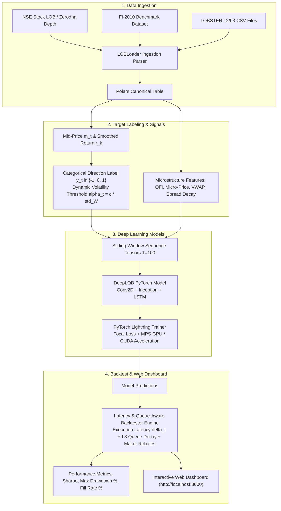

# High-Frequency Limit Order Book (LOB) Mid-Price Prediction & Execution Backtesting Framework

[](https://www.python.org/downloads/)
[](https://pytorch.org/)
[](https://pola.rs/)
[](tests/)
[](LICENSE)

An end-to-end, production-grade Quantitative Research Framework in Python for High-Frequency Limit Order Book (LOB) Mid-Price Directional Prediction and Latency-Aware Strategy Execution Backtesting.

Designed for quantitative researchers, MLOps engineers, and high-frequency trading (HFT) strategy developers working on **NSE India equities/futures**, **LOBSTER (L2/L3)**, and **FI-2010 benchmark datasets**.

---

## Key Features

- **High-Performance Data Ingestion**: Zero-copy tick processing using **Polars** and **PyArrow** for sub-millisecond memory-efficient LOB data manipulation.
- **Market Microstructure Signals**: Vectorized extraction of:
  - **Multi-Level Order Flow Imbalance (OFI)** across top 10 depth levels based on *Cont et al. (2014)*.
  - **Level-1 Micro-Price** skewness: $P_{\text{micro}} = \frac{v^{\text{bid}} \cdot p^{\text{ask}} + v^{\text{ask}} \cdot p^{\text{bid}}}{v^{\text{bid}} + v^{\text{ask}}}$.
  - **Deep Queue Volume Imbalance** across $N$ depth levels: $I_t = \frac{\sum v^{\text{bid}} - \sum v^{\text{ask}}}{\sum v^{\text{bid}} + \sum v^{\text{ask}}}$.
  - **Bid-Ask Spread & Multi-Level Exponential Depth Decay** profiles.
  - **Volume-Weighted Average Price (VWAP)** and rolling price deviations.
- **Deep Spatial-Temporal Neural Networks**:
  - **`DeepLOB` Architecture** (*Zhang et al. 2019*): 2D spatial convolutions, multi-scale Inception blocks, and LSTM temporal sequence modeling over sequence length $T=100$.
  - **`SpatialTemporalTransformerLOB`**: Multi-Head Self-Attention Transformer for long-range temporal dependencies.
  - **Class Imbalance Handling**: Multi-Class **Focal Loss** ($\text{FL}(p_t) = -\alpha_t (1-p_t)^\gamma \log(p_t)$) and Class-Weighted Cross-Entropy.
- **Latency & Queue-Aware Backtest Engine**:
  - **Execution Latency Delay**: Introduces fixed delay parameter $\Delta t$ ticks between signal generation and order queue placement.
  - **L3 Order Queue Priority Model**: Tracks volume ahead in the queue and simulates queue priority decay.
  - **Transaction Cost Model**: Accounts for Maker rebates vs. Taker fees and tick slippage.
  - **Inventory Risk Penalty**: Penalizes unhedged directional holding costs ($\lambda_{\text{inv}} \cdot q_t^2$).
- **Interactive Human-Friendly Web Dashboard**: Real-time browser visualization (`http://localhost:8000`) featuring LOB 10-level depth bars, AI prediction inspector, live latency sliders, and trade logs.

---

## Pipeline Architecture



---

## Project Structure

```
HFTP/
├── src/
│   ├── data/
│   │   ├── loader.py         # Ingestion for NSE, FI-2010, & LOBSTER L2/L3 datasets
│   │   ├── targets.py        # Smoothed return calculation & dynamic target labeling
│   │   └── dataset.py        # PyTorch LOBSequenceDataset & label index mapping
│   ├── features/
│   │   └── microstructure.py # OFI, Micro-Price, Queue Imbalance, Spread, VWAP
│   ├── models/
│   │   ├── deeplob.py        # DeepLOB & SpatialTemporalTransformer architectures
│   │   ├── loss.py           # Focal Loss & Class-Weighted Cross Entropy
│   │   └── lightning_module.py # PyTorch Lightning Module & metric loggers
│   ├── backtest/
│   │   ├── engine.py         # Event-driven microstructure backtesting engine
│   │   ├── metrics.py        # Sharpe, Max Drawdown %, Fill Rate %, Profit Factor
│   │   └── sensitivity.py    # Latency & inventory sensitivity grid sweeper
│   └── dashboard/            # Human-friendly interactive Web Dashboard
│       ├── index.html
│       ├── styles.css
│       └── app.js
├── tests/                    # 24 Unit Tests (100% Pass Rate)
│   ├── test_loader.py
│   ├── test_targets.py
│   ├── test_microstructure.py
│   ├── test_models.py
│   ├── test_dataset.py
│   ├── test_sensitivity.py
│   └── test_backtest.py
├── examples/
│   ├── pipeline_demo.py     # End-to-End Pipeline Demo
│   └── sensitivity_demo.py  # Latency Sensitivity Sweeper Demo
├── train.py                  # PyTorch Lightning Training CLI
├── analyze_dataset.py        # Exploratory Data Analysis (EDA) Tool for LOB data
├── run_dashboard.py          # Dashboard Web Server Launcher
├── requirements.txt          # Python dependencies
└── environment.yml           # Anaconda Conda environment file
```

---

## Quick Start

### 1. Installation

Clone the repository and set up the Conda environment:

```bash
git clone https://github.com/sun-9545sunoj/HFTP.git
cd HFTP

# Option A: Create environment using Conda
conda env create -f environment.yml
conda activate hft_lob_env

# Option B: Create environment using Pip
python3 -m venv .venv
source .venv/bin/activate
pip install -r requirements.txt
```

### 2. Run Test Suite (24 Unit Tests)

Execute all 24 unit tests covering data loaders, microstructure features, deep learning models, target labeling, and backtesting:

```bash
PYTHONPATH=. pytest tests/ -v
```

### 3. Launch Interactive Web Dashboard

Launch the human-friendly interactive web dashboard at **[http://localhost:8000](http://localhost:8000)**:

```bash
python run_dashboard.py
```

---

## Dataset Training Guide

`train.py` supports training on **NSE Stock LOB datasets**, **FI-2010 benchmark datasets**, and **LOBSTER L2/L3 CSV files**:

### **Train on NSE Stock Data** (e.g. RELIANCE, TCS, INFOSYS)
```bash
python train.py \
  --dataset_type nse \
  --file_path data/raw/RELIANCE_NSE_LOB.csv \
  --model_type deeplob \
  --epochs 10 \
  --batch_size 32
```

### **Train on FI-2010 Benchmark Dataset**
```bash
python train.py \
  --dataset_type fi2010 \
  --file_path data/raw/Train_Dst_NoAmbush_5.txt \
  --model_type deeplob \
  --epochs 10
```

### **Train on LOBSTER Dataset**
```bash
python train.py \
  --dataset_type lobster \
  --file_path data/raw/AAPL_2025-01-01_orderbook_10.csv \
  --message_path data/raw/AAPL_2025-01-01_message_10.csv \
  --model_type deeplob \
  --epochs 10
```

---

## Backtesting & Sensitivity Analysis

Run latency sensitivity grid sweeps across execution delays ($\Delta t \in [1, 2, 5, 10, 20]$ ticks), queue decay rates, and inventory risk holding penalties:

```bash
PYTHONPATH=. python examples/sensitivity_demo.py
```

---

## License

Distributed under the MIT License. See `LICENSE` for details.
